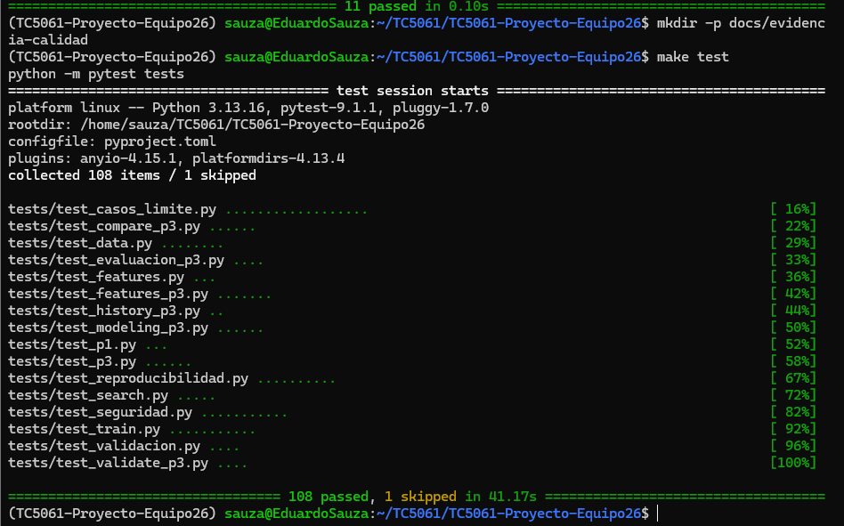
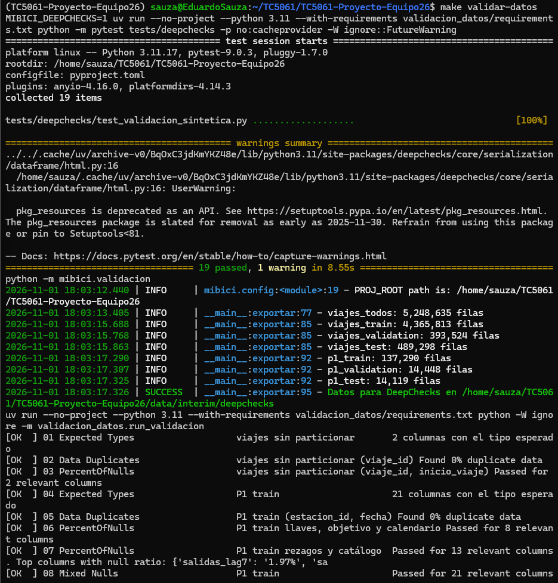
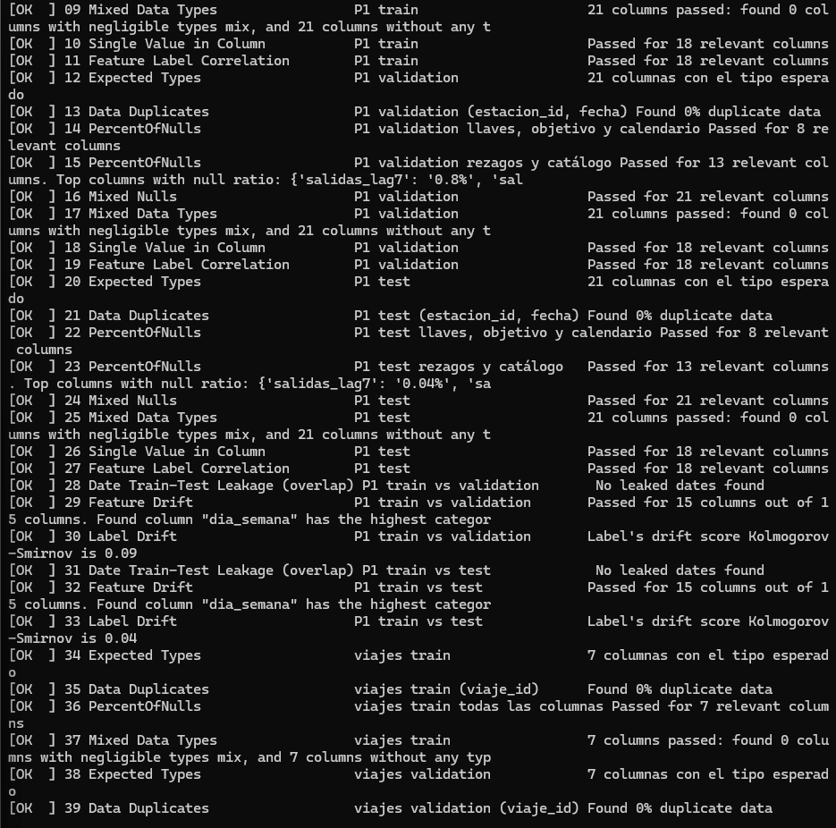
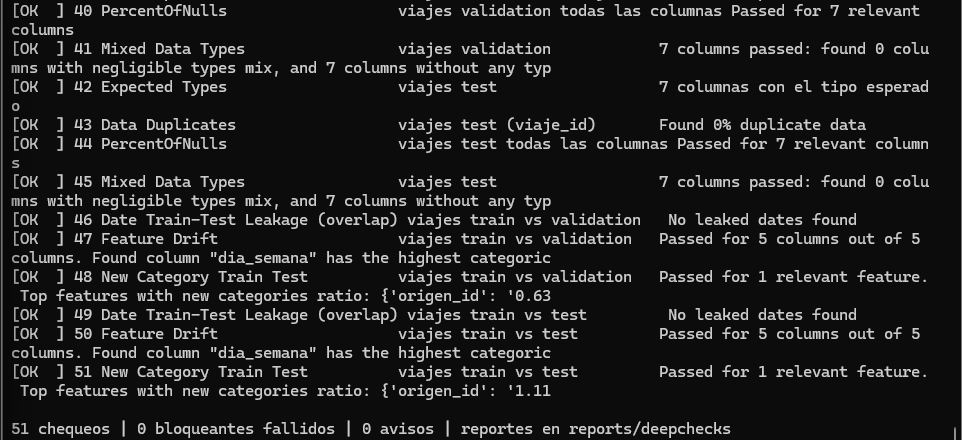
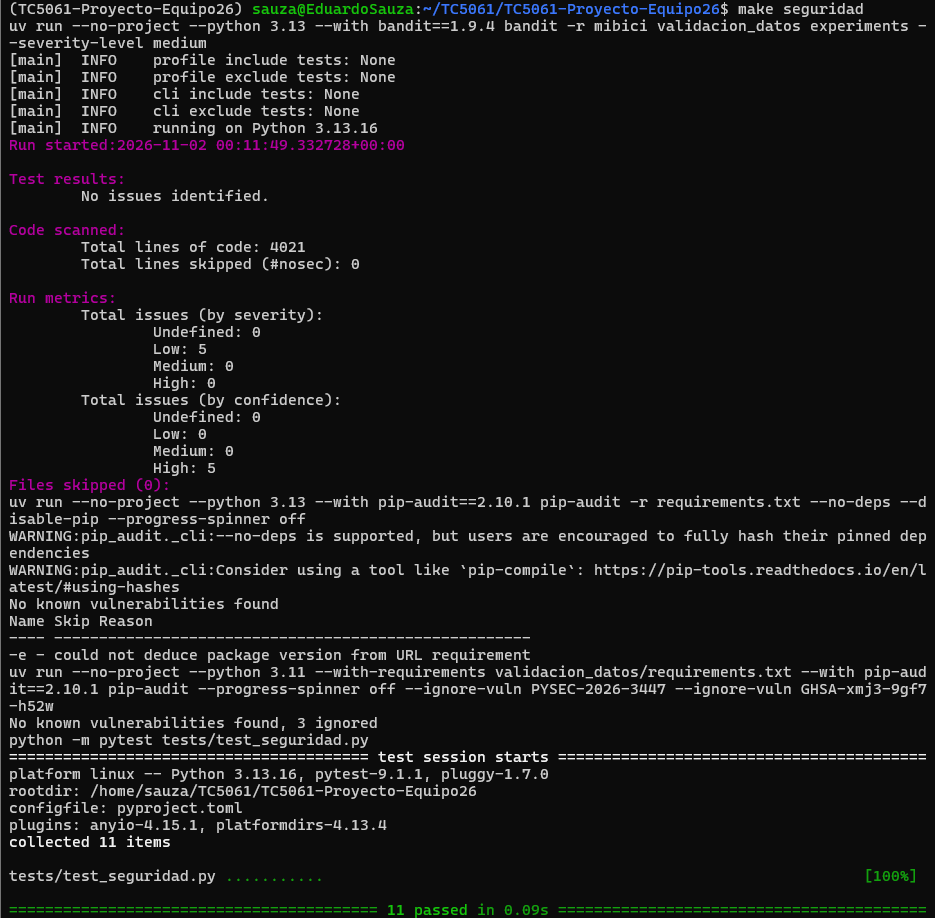
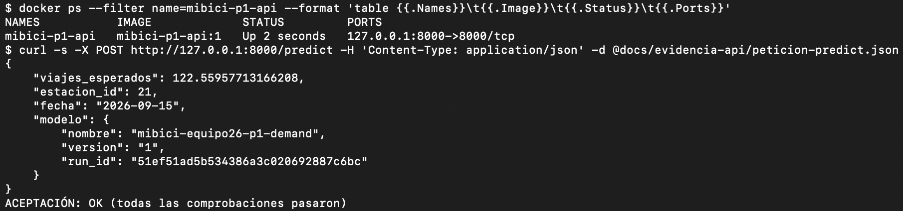

# Proyecto MiBici Equipo 26

<a target="_blank" href="https://cookiecutter-data-science.drivendata.org/">
    
</a>

Proyecto integrador de TC5061 Operaciones de Aprendizaje Automático. Usamos los
datos abiertos de MiBici, el sistema de bicicleta pública del Área Metropolitana
de Guadalajara, para estimar la demanda por estación, aproximar el riesgo de
quedarse sin bicicletas o sin anclajes y agrupar estaciones con patrones de uso
parecidos.

## Preguntas del proyecto

| # | Pregunta | Tarea | Usuario |
|---|---|---|---|
| P1 | ¿Cuántos viajes se iniciarán en cada estación el día siguiente? | Regresión | Operador del sistema, para planear la flota. |
| P2 | ¿Qué estaciones están en riesgo de quedarse sin bicicletas o sin anclajes el día siguiente? | Clasificación | Equipo de rebalanceo, para decidir qué estaciones revisar primero. |
| P3 | ¿Qué grupos de estaciones comparten patrones de uso y dónde se ubican? | Clustering | Planeación urbana y expansión del sistema. |

Los datos no incluyen el inventario por estación. El riesgo de P2 se aproxima con
el saldo de salidas y llegadas y la capacidad de cada estación. La formulación
completa está en el [ML Canvas](references/ML_Canvas_MiBici.pdf) y la arquitectura en
[references/arquitectura.md](references/arquitectura.md).

## Datos

- **Fuente:** [datos abiertos de MiBici](https://mibici.net/es/datos-abiertos/):
  viajes mensuales (`datos_abiertos_AAAA_MM.csv`) y nomenclatura de estaciones
  (`nomenclatura_2026_09.csv`).
- **Periodo:** agosto de 2025 a septiembre de 2026.
- **Partición temporal:** entrenamiento de agosto de 2025 a julio de 2026,
  validación en agosto de 2026 y prueba en septiembre de 2026. Las fechas viven
  en `mibici/config.py`. Las variables solo usan información disponible antes de
  cada pronóstico.
- **Datos personales:** no se usan `Usuario_Id`, `Genero` ni `Año_de_nacimiento`
  como variables, ni se registran en MLflow.

- **Tamaño:** 14 meses, 5,248,635 viajes después de limpieza y entre 367 y 468
estaciones activas por mes (`reports/mibici_resumen_mensual.csv`).

Los datos no se versionan en Git. `mlflow run . -e ingest` los reconstruye y
actualiza dos manifiestos versionados en `manifests/`:

- `mibici_downloads.json`: URL, encoding, columnas, registros y SHA-256 de cada
CSV original, incluida la nomenclatura.
- `mibici_processed.json`: registros limpios, duplicados e inválidos eliminados,
SHA-256 de cada Parquet y el `data_version`, un identificador de 12 caracteres
derivado de los hashes de los CSV originales. Ese valor se registra en cada run
de MLflow; si MiBici modifica un archivo, cambia la versión.

## Estructura del repositorio

```
├── MLproject          <- MLflow Project: puntos de entrada ingest, train y search
├── python_env.yaml    <- Entorno del MLflow Project (Python + requirements.txt)
├── Makefile           <- Comandos de conveniencia (make requirements, make lint)
├── README.md
├── pyproject.toml     <- Metadatos del paquete y configuración de ruff
├── requirements.in    <- Dependencias directas (se editan aquí)
├── requirements.txt   <- Versiones exactas de todas las dependencias
├── .python-version    <- Versión de Python del proyecto (3.13)
├── Containerfile      <- Imagen OCI del servicio P1 (Docker; compatible con Podman)
├── .dockerignore      <- Contexto de build mínimo (lo leen Docker y Podman)
├── api                <- Servicio FastAPI de P1 (ver docs/especificacion-api-p1.md)
├── scripts            <- registrar_p1.py, exportar_modelo.py y probar_contenedor.sh
├── constraints        <- requirements.txt sin -e . para compilar api/requirements.txt
├── data               <- No se versiona
│   ├── external       <- Datos de terceros
│   ├── interim        <- Datos intermedios
│   ├── processed      <- Datos limpios en Parquet
│   └── raw            <- CSV originales de MiBici
├── docs
├── models             <- Modelos serializados (no se versionan)
├── notebooks          <- Solo exploración: 1.0-iniciales-descripcion.ipynb
├── references         <- ML Canvas, arquitectura y opciones de ccds
├── reports
│   └── figures        <- Gráficas y mapas
├── tests              <- Pruebas con pytest (tests/deepchecks: chequeos con datos sintéticos)
├── validacion_datos   <- Chequeos de DeepChecks y su entorno aislado (requirements.txt)
└── mibici                 <- Código del proyecto
    ├── config.py          <- Rutas, fechas, semilla, umbrales y MLflow en un solo lugar
    ├── dataset.py         <- Ingesta, versionado y lectura verificada contra el manifiesto
    ├── preprocess.py      <- Normalización de CSV a Parquet
    ├── features.py        <- Variables de P1, P2 y P3 (panel estación-día y perfiles de uso)
    ├── evaluation.py      <- Comparación y evaluación de P3 (selección de k, validación, reproducción)
    ├── plots.py           <- Gráficas y mapa de P3
    ├── tracking.py        <- Registro común de runs y artefactos de candidatos en MLflow
    ├── validacion.py      <- Exporta viajes y panel de P1 para DeepChecks
    ├── modeling
    │   ├── train.py       <- Punto de entrada `train`: un modelo de una pregunta
    │   ├── search.py      <- Punto de entrada `search`: búsqueda con nested runs
    │   ├── comparar.py    <- Tabla comparativa por pregunta desde MLflow (reporte)
    │   ├── p1.py          <- Demanda (P1): baseline, HGB Poisson y GLM Poisson
    │   ├── p2.py          <- Riesgo (P2): baseline, regresión logística y HGB
    │   ├── p3.py          <- KMeans de perfiles de estaciones (P3) y auditoría congelada
    │   └── predict.py     <- Inferencia (plantilla)
```

La estructura se generó con Cookiecutter Data Science v2.3.0 (`ccds`, con
`include_code_scaffold` en Yes). Las opciones usadas están en
[references/ccds-options.json](references/ccds-options.json).

## Instalación

Requisitos: Git, Python 3.13 y acceso al repositorio del equipo.
Usamos [uv](https://docs.astral.sh/uv/) para crear el entorno y resolver las
dependencias. Las versiones están fijadas en `requirements.txt`; también se
pueden instalar con pip. Esta modalidad utiliza `requirements.in` y
`requirements.txt`, sin `uv.lock` ni `uv sync`.

```bash
git clone https://github.com/MNA-MLOps-Grupo26/TC5061-Proyecto-Equipo26.git
cd TC5061-Proyecto-Equipo26
```

Con uv (flujo del equipo):

```bash
uv venv --python 3.13
source .venv/bin/activate
uv pip install -r requirements.txt
```

En Windows, sustituye la activación por `.venv\Scripts\Activate.ps1` en
PowerShell o `.venv\Scripts\activate.bat` en CMD. Los ejemplos con `source`
corresponden a macOS/Linux.

Alternativa con pip (requiere Python 3.13 instalado):

```bash
python3.13 -m venv .venv
source .venv/bin/activate
python -m pip install -r requirements.txt
```

En Windows, crea el entorno con `py -3.13 -m venv .venv` y actívalo como arriba.

Si tienes Make y uv, puedes usar `make create_environment`, activar `.venv`
y ejecutar `make requirements`.

### Verificar la instalación

Desde la raíz del repositorio, con `.venv` activo:

```bash
python -m pytest tests
```

Las pruebas cubren la normalización de datos, la partición temporal, los rezagos
sin fuga de información, la etiqueta de riesgo de P2, las métricas de P1 y la
preparación y reproducción de P3. No necesitan los datos de MiBici.
La revisión de estilo es opcional:

```bash
ruff check
ruff format --check
```

### Agregar o quitar una dependencia

1. Agreguen o quiten el paquete en `requirements.in` (sin versión).
2. Regeneren `requirements.txt` con las versiones exactas:

   ```bash
   uv pip compile requirements.in -o requirements.txt --python-version 3.13
   ```

   Sin uv, el equivalente es `pip-compile` de pip-tools.
3. Instalen de nuevo: `uv pip install -r requirements.txt` (o `python -m pip install -r requirements.txt`).
4. Suban `requirements.in` y `requirements.txt` en el mismo commit, por ejemplo
   `build(deps): add pyarrow for Parquet output`.

Reglas:

- No editen `requirements.txt` a mano; siempre se genera desde `requirements.in`.
- Después de hacer pull, vuelvan a correr `uv pip install -r requirements.txt` si
  cambió.
- Si hay conflicto en `requirements.txt`, resuelvan `requirements.in` y vuelvan
  a generarlo.

## Comandos del proyecto

Todas las corridas de la entrega se lanzan desde el MLflow Project (`MLproject`),
no desde notebooks ni scripts sueltos. El entorno está en `python_env.yaml`
(Python 3.13.16 y las versiones fijas de `requirements.txt`).

| Punto de entrada | Qué hace | Parámetros |
|---|---|---|
| `ingest` | Descarga, verifica y normaliza los datos; genera manifiestos con `data_version` | Ninguno |
| `train` | Entrena un modelo (o baseline) de una pregunta | `question`, `model`, `learning_rate`, `max_iter` |
| `search` | Búsqueda de hiperparámetros con nested runs (un padre y un hijo por combinación) | `question`, `model` |

### 1. Servidor de tracking (terminal 1)

```bash
mlflow server \
  --backend-store-uri sqlite:///mlflow.db \
  --artifacts-destination ./mlartifacts \
  --host 127.0.0.1 --port 5000
```

`mlflow.db` y `mlartifacts/` están en `.gitignore`. En macOS, si el puerto 5000
está ocupado (AirPlay Receiver), usen `--port 5001` y ajusten la URI.

### 2. Reproducir desde un clon limpio (terminal 2)

```bash
git clone https://github.com/MNA-MLOps-Grupo26/TC5061-Proyecto-Equipo26.git
cd TC5061-Proyecto-Equipo26
export MLFLOW_TRACKING_URI=http://127.0.0.1:5000
RUN="mlflow run . --env-manager uv --experiment-name mibici-equipo26"

# Ingesta
$RUN -e ingest

# Baselines y candidatos
$RUN -e train -P question=P1 -P model=baseline
$RUN -e train -P question=P1 -P model=hgb
$RUN -e train -P question=P1 -P model=glm
$RUN -e train -P question=P2 -P model=baseline
$RUN -e train -P question=P2 -P model=logreg
$RUN -e train -P question=P2 -P model=hgb
$RUN -e train -P question=P3                      # k=3 congelado (baseline de P3)

# Búsquedas con nested runs (combinaciones en config.BUSQUEDAS)
$RUN -e search -P question=P1                     # hgb: learning_rate y max_iter
$RUN -e search -P question=P2 -P model=logreg     # C
$RUN -e search -P question=P2 -P model=hgb        # learning_rate y max_leaf_nodes
$RUN -e search -P question=P3                     # k = 2, 4, 5

# Tabla comparativa por pregunta para el reporte (solo lee MLflow)
python -m mibici.modeling.comparar
```

- `--env-manager uv` crea el entorno de `python_env.yaml` desde cero y requiere
  `uv` actualizado: se verificó con **uv 0.13.5** y **Python 3.13.16**. Para
  iterar más rápido con `.venv` activo, usen `--env-manager local`.
- `--experiment-name mibici-equipo26` es obligatorio: `mlflow run` crea el run
  del proyecto en ese experimento antes de ejecutar el código.
- Agreguen `--run-name <nombre>` para nombrar el run del proyecto; los runs de
  modelos ya tienen nombre descriptivo.

| Pregunta | `model` en `train` | Hiperparámetros por `-P` | `model` en `search` |
|---|---|---|---|
| P1 | `default` (baseline + hgb), `baseline`, `hgb`, `glm` | hgb: `learning_rate`, `max_iter`; glm: `max_iter` | `hgb` |
| P2 | `default` (baseline + logreg), `baseline`, `logreg`, `hgb` | hgb: `learning_rate`, `max_iter`; logreg: `max_iter` | `logreg`, `hgb` |
| P3 | `default` (k=3) | Ninguno | `kmeans` |

Los valores por defecto viven en `mibici/config.py` (`P1_HIPERPARAMETROS`,
`P1_GLM_HIPERPARAMETROS`, `P2_HIPERPARAMETROS`, `P2_HGB_HIPERPARAMETROS`,
`P3_HIPERPARAMETROS` y `BUSQUEDAS`).

La ingesta reutiliza los CSV que ya estén en `data/raw` y solo consulta el
portal si falta alguno (~600 MB en una computadora nueva). Si cambian los
manifiestos, súbanlos en un commit antes de entrenar: cada run registra el
commit y marca `git_dirty=true` si había cambios de código sin commit.

Pruebas y estilo: `make test` y `make lint` (`ruff check` y `ruff format
--check` sobre `mibici/`, `tests/` y `validacion_datos/`). La validación de
datos y los chequeos de seguridad se describen en la siguiente sección.

## Pruebas y validación de datos

La [revisión de P1 en Windows del 8 de noviembre](docs/revision-windows-p1.md)
reúne la nueva corrida de DeepChecks, la auditoría de seguridad y las pruebas
del contenedor, con sus límites de procedencia y pendientes.

| Comando | Qué corre | Requiere datos |
|---|---|---|
| `make test` | Toda la suite de pytest del proyecto | No |
| `make test-deepchecks` | Pruebas de los chequeos de DeepChecks con datos sintéticos | No |
| `make validar-datos` | Lo anterior + DeepChecks sobre los datos reales | Sí (`mlflow run . -e ingest`) |
| `make seguridad` | bandit, pip-audit y búsqueda de secretos versionados | No |
| `make calidad` | `make test`, `make validar-datos` y `make seguridad` en un solo comando | Sí |

**Pruebas unitarias (`tests/`).** Cubren ingesta, variables de P1/P2/P3,
métricas, baselines, partición temporal y casos límite (`test_casos_limite.py`).
`test_reproducibilidad.py` arma paneles con viajes sintéticos, entrena cada
candidato de P1 (HGB, GLM) y P2 (regresión logística, HGB) dos veces con la
semilla de `config.py` y verifica que predicciones, probabilidades y métricas
sean idénticas, incluso si se altera el estado global de numpy entre corridas.

**Validación de datos con DeepChecks.** `deepchecks` 0.19.1 (la última versión)
no es compatible con numpy 2 ni con scikit-learn >= 1.6, que usa el proyecto.
Por eso corre en un entorno aislado de Python 3.11 que `uv` crea y reutiliza
(`validacion_datos/requirements.txt`). El flujo es:

1. `python -m mibici.validacion` (entorno del proyecto) exporta a
   `data/interim/deepchecks/` los viajes y el panel de P1 de cada partición
   (completos, sin muestreo), `viajes_todos.parquet` (`viaje_id` e inicio de
   todos los viajes, antes de filtrar por periodo y de particionar) y
   `esquema.json` con las columnas.
2. `validacion_datos/run_validacion.py` (entorno de DeepChecks) corre los
   chequeos, guarda `reports/deepchecks/reporte.html` y `resumen.json`, y
   termina con error si falla un chequeo bloqueante.

Los chequeos bloqueantes revisan todas las filas (`n_samples=None`): por
defecto DeepChecks toma una muestra (100 000 filas en `PercentOfNulls`) y un
duplicado o un nulo fuera de ella pasaría sin fallar. Los de drift sí muestrean.

| Chequeo | Datos | Tipo |
|---|---|---|
| Tipo esperado por columna: numérico o fecha (chequeo propio, `TiposEsperados`) | P1, viajes | Bloqueante |
| Inicio nulo y `viaje_id` repetido entre particiones | viajes sin particionar | Bloqueante |
| Duplicados de llave (`viaje_id`; `estacion_id` + `fecha`) | viajes, P1 | Bloqueante |
| Nulos en llaves, fecha, objetivo y calendario (P1); en llaves, fecha y variables (viajes) | P1, viajes | Bloqueante |
| Nulos mezclados y tipos de dato mezclados | P1, viajes | Bloqueante |
| Fechas de validación o prueba dentro de entrenamiento | P1, viajes | Bloqueante |
| Nulos en rezagos y catálogo de estaciones (<= 10%) | P1 | Informativo |
| Columnas con un solo valor | P1 | Informativo |
| Correlación variable-objetivo (PPS < 0.9, posible fuga) | P1 | Informativo |
| Drift de variables y del objetivo (train vs validación y prueba) | P1, viajes | Informativo |
| Estaciones nuevas en validación y prueba | viajes | Informativo |

Dos controles cubren huecos de DeepChecks y del filtrado previo:

- `MixedDataTypes` solo falla si el tipo minoritario ocupa entre 1 % y 10 % de
  la columna; unos pocos textos en una columna numérica, o una columna entera de
  texto, pasarían. `TiposEsperados` exige el tipo de cada columna.
- `cargar_viajes()` filtra por periodo y un inicio nulo no cumple el filtro, así
  que se descartaría sin aviso. Por eso los inicios nulos y los `viaje_id`
  repetidos entre particiones se revisan en `viajes_todos.parquet`.

El drift es informativo porque entrenamiento (ago 2025 - jul 2026) y prueba
(sep 2026) cubren temporadas distintas. `mes`, `dia_mes` y `dias_historia` se
excluyen del drift: cambian por construcción entre particiones.

**Seguridad (`make seguridad`).** bandit y pip-audit corren en entornos
efímeros de `uv` con versiones fijas (bandit 1.9.4, pip-audit 2.10.1), así que
no se agregan a `requirements.txt`. El comando termina con error si:

1. **bandit** (`-r mibici validacion_datos --severity-level medium`) encuentra
   un problema de severidad media o alta en el código.
2. **pip-audit** encuentra una vulnerabilidad conocida en `requirements.txt` o
   en cualquier paquete instalado del entorno de DeepChecks (incluye las
   dependencias transitivas, que `validacion_datos/requirements.txt` no fija).
3. **`tests/test_seguridad.py`** detecta que `.gitignore` deja de excluir
   `.env`, datos, `mlflow.db`, modelos o reportes, que se versiona un archivo de
   credenciales (`.env`, `.pem`, `.key`, `id_rsa`) o que un archivo versionado
   contiene un secreto (llaves privadas, llaves de AWS, tokens de GitHub o
   Slack, URLs con contraseña o asignaciones como `api_key = "..."`).

La configuración sensible se lee de variables de entorno: `mibici/config.py`
carga `.env` con `python-dotenv` y `MLFLOW_TRACKING_URI` puede sobrescribir el
servidor de MLflow. Copien `.env.example` como `.env`; `.env` y `.env.*` están
en `.gitignore` y nunca se han versionado.

Resultados de la revisión (31 de octubre de 2026):

| Herramienta | Hallazgo | Acción |
|---|---|---|
| bandit | 0 de severidad media o alta. 5 de severidad baja: `subprocess` en `dataset.py` (`curl`) y `tracking.py` (`git`) | Revisados y aceptados: los comandos se pasan como lista, sin `shell=True`; `git` recibe argumentos fijos y `curl` solo la URL del portal y enlaces filtrados por una expresión regular |
| pip-audit (proyecto) | 10 vulnerabilidades en certifi, mlflow, pyasn1 y tornado | Actualizados a certifi 2026.10.23, mlflow 3.17.2, pyasn1 0.6.5 y tornado 6.6; 0 pendientes |
| pip-audit (DeepChecks) | pyarrow 17.0.0, pytest 8.3.5 y setuptools 75.8.0 | Actualizados a pyarrow 23.0.1, pytest 9.0.3 y setuptools 81.0.0 |
| pip-audit (DeepChecks) | setuptools 81.0.0: PYSEC-2026-3447 y GHSA-xmj3-9gf7-h52w | **Riesgo aceptado** (ver abajo) |

#### Riesgos aceptados

`make seguridad` ignora estas dos vulnerabilidades (`IGNORAR_SETUPTOOLS` en el
`Makefile`). No están corregidas: son una decisión del equipo con su
justificación.

| ID | Paquete y entorno | Qué afecta | Por qué se acepta |
|---|---|---|---|
| PYSEC-2026-3447 (corregida en 83.0.0) | setuptools 81.0.0, solo en el entorno de DeepChecks | Directivas `exclude` de `MANIFEST.in` al construir un sdist | El entorno no construye paquetes: setuptools solo aporta `pkg_resources`, que deepchecks importa al arrancar |
| GHSA-xmj3-9gf7-h52w (corregida en 84.1.0) | setuptools 81.0.0, solo en el entorno de DeepChecks | Instalación legacy de wheels (eggs) en Windows | uv instala los paquetes del entorno; no se usa la ruta legacy de setuptools |

No se pueden corregir porque setuptools 82 y posteriores quitan
`pkg_resources` y deepchecks 0.19.1 (su última versión) deja de importar;
`make test-deepchecks` falla en ese caso. El entorno del proyecto no está
afectado: no fija setuptools y pip-audit no reporta nada en él. Hay que revisar
esta decisión si deepchecks publica una versión sin `pkg_resources` o si
aparece una vulnerabilidad de setuptools que sí afecte su uso en tiempo de
ejecución.

Después de actualizar dependencias corran `uv pip install -r requirements.txt`.

### Evidencia de ejecución







## Experimentos en MLflow

- Experimento único: `mibici-equipo26`. Todos los runs pasan por
  `mibici/tracking.py`, que registra los mismos parámetros y etiquetas.
- Jerarquía: cada `mlflow run` crea un run de proyecto (`stage_of_work=project`);
  cada modelo es su hijo. En `search`, el padre de la búsqueda cuelga del run
  de proyecto y cada combinación es hija del padre de la búsqueda.
- Parámetros: rango de fechas, `data_version`, semilla, modelo, hiperparámetros
  efectivos y `selection_metric`.
- Etiquetas: `team`, `question`, `model`, `model_family`, `stage_of_work`
  (`project`, `baseline`, `search`, `candidate`), `git_commit` y `git_dirty`.
  Ejemplo de filtro en la interfaz: `tags.question = 'P2' and tags.stage_of_work != 'project'`.
- Métricas con el conjunto en el nombre (`train_`, `val_`, `test_`), más
  `fit_time_s` como costo de entrenamiento.
- Artefactos de cada candidato:

  | Carpeta | Contenido |
  |---|---|
  | `model` (Logged model) | Modelo sklearn con firma y ejemplo de entrada |
  | `data/` | Manifiestos de la ingesta; el entrenamiento se registra como input del run (`log_input`: esquema, perfil y digest, sin filas) |
  | `config/` | `run_config.json` (hiperparámetros efectivos, partición, variables) y `config.py` |
  | `plots/` | P1: real vs. predicho, residuales y serie diaria; P2: matriz de confusión y curva precisión-recall; P3: mapa y perfiles de grupos |
  | `tables/` | P1: predicciones por estación-día; P2 logística: coeficientes; P3: asignaciones, perfiles y resultados agregados. Los candidatos HGB de P2 no generan esta carpeta en la implementación actual. Sin datos personales. |

- Selección (validación elige, prueba solo se reporta):

  | Pregunta | Métrica de negocio | Apoyo |
  |---|---|---|
  | P1 | `val_wape` (menor) | `val_mae`, `val_rmse` |
  | P2 | `val_recall_at_30` (mayor) | `val_precision_at_30`, `val_f1_macro` |
  | P3 | `val_ari_vs_train` (mayor) | `val_fraccion_estable`, `train_silhouette`, interpretabilidad |

  `python -m mibici.modeling.comparar` arma esta comparación con la mejora
  respecto al baseline, la brecha validación-prueba (estabilidad) y
  `fit_time_s` (costo). La metodología y la decisión están en
  [references/BUSQUEDA_CANDIDATOS.md](references/BUSQUEDA_CANDIDATOS.md).
- Sin credenciales ni datos personales en parámetros, etiquetas o artefactos.
- P3 fija su configuración en `references/p3_frozen.json` (elegida sin ver
  prueba). El run agrega la etiqueta `reproduce_configuracion_congelada=true`
  cuando sus métricas coinciden con las registradas al congelarla.
- La secuencia con la que se eligió esa configuración (revisión, comparación de
  k, sensibilidad a la historia y validación en agosto) está en
  `notebooks/2.0-fvep-p3-seleccion.ipynb`, y la auditoría de la evaluación
  congelada en `notebooks/3.0-fvep-p3-auditoria.ipynb`. El protocolo está en
  [references/P3_REPRODUCIBILIDAD.md](references/P3_REPRODUCIBILIDAD.md).

**Limitación conocida:** el hash de `data/processed/estaciones.parquet` puede
variar entre sistemas operativos aunque el contenido sea el mismo. Si la ingesta
modifica ese valor en `manifests/mibici_processed.json`, el run queda con
`git_dirty=true`. `data_version` no cambia, porque se calcula con los CSV
originales.

## Servicio de predicción P1 (API REST en contenedor)

Actividad 8: el modelo de demanda P1 se sirve como API REST con FastAPI dentro de
un contenedor OCI. El procedimiento principal usa Docker; el mismo `Containerfile`
es compatible con Podman.

**Estado:** el modelo está recuperado del Model Registry y empaquetado en la imagen,
la API (`api/`) está implementada según la [especificación](docs/especificacion-api-p1.md)
y la prueba de aceptación dentro del contenedor pasa (`ACEPTACIÓN: OK`); la evidencia
está en [docs/evidencia-api/](docs/evidencia-api/).

### Estrategia de despliegue

- **Modelo servido:** P1, salidas esperadas por estación el día siguiente. Sus 18
  variables son numéricas con rangos claros y la salida es un número no negativo,
  lo que permite un contrato de validación estricto.
- **Recuperación del modelo:** se descarga del Model Registry de MLflow por nombre y
  versión numérica (el alias `champion` se resuelve una sola vez) y se **empaqueta
  en la imagen** junto con `registry.json`, que guarda su linaje y el SHA-256 de cada
  archivo. El contenedor no depende de que el servidor de MLflow esté encendido y
  la imagen es reproducible en cualquier máquina.
- **Tipo de inferencia:** el caso de uso es un pronóstico diario por estación, que
  encaja con inferencia por lotes. El servicio atiende peticiones en línea bajo
  demanda (`/predict`) y ofrece `/predict/batch` (hasta 500 registros) para la
  corrida diaria de todas las estaciones activas.

### Modelo servido y linaje

| Campo | Valor |
|---|---|
| Modelo registrado / versión / alias | `mibici-equipo26-p1-demand` / `1` / `champion` |
| Run | `51ef51ad5b534386a3c020692887c6bc` (`p1-hgb-lr0.05-it300`) |
| Logged model | `m-8917791035574d139539ba27ae896ad4` |
| Commit / árbol | `8c7c709` (merge del PR #10) / `git_dirty=false` |
| Datos | `data_version` `cd917f9aa025`; 14 Parquet de viajes y `estaciones.parquet` verificados por SHA-256 contra el manifiesto |
| Almacén MLflow | `mlflow-p1-store-20261107`, fuera del repositorio (no se versiona) |
| Reproducción de | run `9d55326449364961b1cbc585ac28cefe`, logged model `m-a1ba41ed76654e6fa8eb2fd611b2bd88` (registro del 24 de octubre, almacén no disponible) |

El registro del 24 de octubre se hizo en un almacén local que ya no existe, así que
el modelo se reentrenó desde el commit fuente en un clon y un almacén nuevos.
La nueva corrida coincide con los 16 parámetros y las tres métricas de validación
publicadas. Su digest de entrenamiento es e3b4786b, frente a 10f3651e del original.
La causa no está identificada; no se afirma identidad del conjunto de entrenamiento
ni del binario original. La investigación queda pendiente y no bloquea la API.

Evidencia en [docs/evidencia-api/](docs/evidencia-api/):
[recibo del almacén y la reproducción](docs/evidencia-api/recibo-registro-p1.json),
[metadatos de la exportación](docs/evidencia-api/exportacion-registry.json) y
[predicciones de referencia del modelo exportado](docs/evidencia-api/prediccion-referencia.json),
calculadas sin API para las peticiones de ejemplo.

### Componentes

| Archivo | Función | Estado |
|---|---|---|
| `scripts/exportar_modelo.py` | Registry → directorio nuevo `models/p1` con `registry.json` (hashes y linaje) | Listo |
| `scripts/registrar_p1.py` | Registro seguro de un run concreto en un almacén nuevo (solo para reproducir desde cero) | Listo |
| `constraints/base.txt` | `requirements.txt` sin la línea `-e .`, para usarlo como restricción | Listo |
| `Containerfile`, `.dockerignore` | Imagen con usuario no root; copia `api/` y el modelo exportado | Listo |
| `scripts/probar_contenedor.sh` | Build, ejecución y prueba de aceptación del contenedor con evidencia y captura | Listo |
| `docs/evidencia-api/peticion-*.json` | Peticiones de ejemplo (filas reales del panel de P1) | Listo |
| `api/esquemas.py` | Contrato de entrada y salida (Pydantic): 18 variables, rangos, tipos estrictos y 7 reglas cruzadas | Listo |
| `api/modelo.py` | Verificación de SHA-256 contra `registry.json`, carga con `mlflow.pyfunc` y verificación de la firma | Listo |
| `api/main.py` | App FastAPI: `/health`, `/predict`, `/predict/batch`, `/docs`; 422 y 500 controlados | Listo |
| `api/requirements.in`, `api/requirements.txt` | Dependencias del servicio, fijadas con `constraints/base.txt` | Listo |

### Contrato de la API

| Endpoint | Entrada | Salida |
|---|---|---|
| `GET /health` | - | `estado`, linaje del modelo (`registry.json`) y resultado de la verificación |
| `POST /predict` | Un registro con las 18 variables de P1; `estacion_id` y `fecha` opcionales | `viajes_esperados`, `estacion_id`, `fecha`, `modelo` |
| `POST /predict/batch` | `{"registros": [...]}` con 1 a 500 registros | `n` y `predicciones` en el orden de entrada (`indice`) |
| `GET /docs` | - | Documentación interactiva (Swagger) con un ejemplo válido |

Validación de entrada (`api/esquemas.py`): las 18 claves son requeridas (algunas
aceptan `null`), se rechazan campos desconocidos, textos, booleanos, NaN, infinitos y
decimales en campos enteros, se validan rangos y siete reglas cruzadas (por ejemplo,
`es_fin_semana` coherente con `dia_semana` y `saldo_lag1 = salidas_lag1 - llegadas_lag1`).
Cualquier violación responde **422** con el campo y el motivo. La salida también se
valida: si el modelo devuelve valores negativos, NaN, infinitos o una longitud distinta,
la API responde **500** con un mensaje controlado.

Al arrancar, el servicio verifica que los archivos del modelo coincidan con los SHA-256
de `registry.json` y que la firma del modelo sean las 18 variables en orden. Si algo
falla, el contenedor no arranca.

**Ejemplo de petición y respuesta** (obtenido del contenedor en ejecución):

```bash
curl -s -X POST http://127.0.0.1:8000/predict \
  -H "Content-Type: application/json" -d @docs/evidencia-api/peticion-predict.json
```

```json
{
  "viajes_esperados": 122.55957713166208,
  "estacion_id": 21,
  "fecha": "2026-09-15",
  "modelo": {
    "nombre": "mibici-equipo26-p1-demand",
    "version": "1",
    "run_id": "51ef51ad5b534386a3c020692887c6bc"
  }
}
```

Una petición incoherente (martes marcado como fin de semana) responde 422:

```json
{"detail": [{"loc": ["body"], "msg": "Value error, es_fin_semana no coincide con dia_semana (1 solo si dia_semana >= 5)", "type": "value_error", "input": {"...": "..."}}]}
```



### Pruebas de la API

```bash
python -m pytest tests/test_api_esquemas.py tests/test_api_servicio.py   # modelo falso
MIBICI_MODELO_EXPORTADO=models/p1 python -m pytest tests/test_api_modelo_real.py
```

### Construir y ejecutar con Docker (almacén entregado)

Desde la raíz del repositorio, con el entorno del
proyecto activo y Docker en ejecución (`docker info` debe responder sin error).

**Atajo para los pasos 3 a 6:** `bash scripts/probar_contenedor.sh`. En macOS abre
Docker Desktop si no responde, construye la imagen, levanta el contenedor en
`127.0.0.1:8000`, comprueba el usuario no root y que el modelo y la API sean de solo
lectura, exige HTTP 200 en `/health`, `/predict` y `/predict/batch`, exige un 422
ante una petición incoherente y exige que las predicciones sean idénticas a la
[referencia](docs/evidencia-api/prediccion-referencia.json). Si cualquier comprobación
falla, termina con código distinto de 0 y no toma la captura. Guarda la salida en
`docs/evidencia-api/contenedor-docker.txt` y el log del build en
`docs/evidencia-api/contenedor-docker-build.log`, y en Terminal.app toma la captura
de la ventana. Nunca sobrescribe evidencia ni toca un contenedor existente con el
mismo nombre o un puerto ocupado. Para Podman: `MOTOR=podman bash
scripts/probar_contenedor.sh`.

1. **Levantar el registry** del almacén aislado (terminal 1; puerto libre y rutas
   absolutas, sin tocar otros servidores):

   ```bash
   STORE="$(cd .. && pwd)/mlflow-p1-store-20261107"
   mlflow server --backend-store-uri "sqlite:///$STORE/mlflow.db" \
     --artifacts-destination "$STORE/mlartifacts" --host 127.0.0.1 --port 5055 --workers 1
   ```

2. **Exportar el modelo** a un directorio nuevo (terminal 2). El script se niega a
   sobrescribir: si `models/p1` ya existe, úsenlo tal cual o elijan otro destino y
   pásenlo después con `--build-arg MODEL_DIR=<destino>`. Quien no tenga el almacén
   puede recibir la carpeta `models/p1/` completa: al arrancar, la API verifica sus
   hashes contra `registry.json`.

   ```bash
   python scripts/exportar_modelo.py --tracking-uri http://127.0.0.1:5055 \
     --destino models/p1 --recibo-almacen docs/evidencia-api/recibo-registro-p1.json
   ```

3. **Construir la imagen:**

   ```bash
   docker build -f Containerfile -t mibici-p1-api:1 .
   ```

   Si la etiqueta `python:3.13.16-slim` no está disponible, usen
   `--build-arg PYTHON_IMAGE=python:3.13-slim`.

4. **Ejecutar el contenedor** publicando el puerto de forma explícita:

   ```bash
   docker run -d --name mibici-p1-api -p 127.0.0.1:8000:8000 mibici-p1-api:1
   docker logs mibici-p1-api
   ```

5. **Consumir la API:**

   ```bash
   curl -s http://127.0.0.1:8000/health
   curl -s -X POST http://127.0.0.1:8000/predict \
     -H "Content-Type: application/json" -d @docs/evidencia-api/peticion-predict.json
   curl -s -X POST http://127.0.0.1:8000/predict/batch \
     -H "Content-Type: application/json" -d @docs/evidencia-api/peticion-batch.json
   ```

6. **Captura para la entrega:** en una sola terminal ejecuten `docker ps --filter
   name=mibici-p1-api` (debe verse el contenedor con el puerto
   `127.0.0.1:8000->8000/tcp`) y luego el `curl` de `/predict`. Guarden la captura
   como `docs/evidencia-api/captura-contenedor.png`.

7. **Detener:** `docker stop mibici-p1-api && docker rm mibici-p1-api`.

Con Podman los comandos son los mismos cambiando `docker` por `podman`. Ambos leen
`.dockerignore`.

Al arrancar, MLflow avisará que el modelo declara `mlflow==3.17.1` (y `psutil`,
`pytest` y `rich`, que MLflow infirió al guardarlo) mientras el servicio usa
3.17.2. Los metadatos del modelo no se modifican para ocultar el aviso; la carga
y las predicciones se verificaron idénticas con ambas versiones.

### Pruebas del registrador

```bash
python -m pytest tests/test_registrar_p1.py
```

Usan almacenes SQLite temporales y nunca tocan el almacén entregado. Cubren el modo
de revisión, el registro con alias, la reutilización de un registro que ya coincide,
parámetros distintos, métricas NaN o infinitas, conflictos de versión o alias y un
fallo de servidor simulado, que detiene el script sin escribir.

### Reproducir el modelo desde cero (clon y almacén independientes)

Solo es necesario si no tienen el almacén entregado. Todo ocurre en un clon nuevo y
en un almacén nuevo: **no ejecuten `ingest` en la copia de trabajo del equipo ni
sobre sus datos**, porque la ingesta reescribe `data/` y puede cambiar
`manifests/mibici_processed.json` (ver el caveat de la
[evidencia del 24 de octubre](docs/evidence/2026-10-24-final/README.md)).

```bash
# 1. Clon nuevo y árbol de trabajo en el commit del entrenamiento
git clone https://github.com/MNA-MLOps-Grupo26/TC5061-Proyecto-Equipo26.git p1-repro
cd p1-repro
git worktree add ../p1-repro-8c7c709 8c7c709feb1a118f1a87a931e4a362492fa3f744

# 2. Almacén nuevo y exclusivo fuera de los repositorios. mktemp -d crea siempre una
#    carpeta nueva con sufijo aleatorio; si falla, && impide arrancar el servidor.
STORE="$(mktemp -d "$HOME/mlflow-p1-repro-XXXXXX")" && echo "Almacén nuevo: $STORE" && \
  mlflow server --backend-store-uri "sqlite:///$STORE/mlflow.db" \
    --artifacts-destination "$STORE/mlartifacts" --host 127.0.0.1 --port 5056 --workers 1
# En otra terminal: crear el experimento en el servidor para que los artefactos
# queden como mlflow-artifacts:/ y no como rutas file:// locales
python -c "from mlflow import MlflowClient; MlflowClient('http://127.0.0.1:5056').create_experiment('mibici-equipo26')"

# 3. Entorno, ingesta en el clon nuevo y entrenamiento del candidato
cd ../p1-repro-8c7c709
uv venv --python 3.13.16 && source .venv/bin/activate && uv pip install -r requirements.txt
export MLFLOW_TRACKING_URI=http://127.0.0.1:5056
mlflow run . -e ingest --env-manager local --experiment-name mibici-equipo26
git status --porcelain   # debe quedar vacío; si cambió el manifiesto, el run tendrá git_dirty=true
mlflow run . -e train -P question=P1 -P model=hgb --env-manager local --experiment-name mibici-equipo26

# 4. Registrar el run concreto (primero en modo revisión) y exportar, desde el clon en main
cd ../p1-repro
python scripts/registrar_p1.py --tracking-uri http://127.0.0.1:5056 --run-id <RUN_ID>
python scripts/registrar_p1.py --tracking-uri http://127.0.0.1:5056 --run-id <RUN_ID> --aplicar
python scripts/exportar_modelo.py --tracking-uri http://127.0.0.1:5056 --destino models/p1 \
  --esperar-version <VERSION> --esperar-run-id <RUN_ID> --esperar-logged-model-id <MODEL_ID>
```

`<RUN_ID>` es el run `p1-hgb-lr0.05-it300` que aparece en la UI del servidor.
`registrar_p1.py` no lo elige por nombre: verifica ese run concreto (16
parámetros, tres métricas de validación finitas con tolerancia 1e-9 y un único
logged model), reutiliza un registro que ya coincida y se detiene sin cambios ante
cualquier conflicto, por ejemplo si `champion` ya apunta a otra versión. Si los
datos de MiBici cambiaron desde la entrega, `data_version` no coincidirá y el
script se detendrá. Si no puede consultar MLflow (conexión, permisos o error del
servidor), también se detiene sin escribir.

## Flujo de trabajo con Git

Seguimos [GitHub Flow](https://docs.github.com/en/get-started/using-github/github-flow):

1. `main` está protegida: los cambios posteriores al commit inicial entran mediante PR.
2. Cada cambio se hace en una rama nueva creada desde `main`.
3. Al terminar se abre un Pull Request hacia `main`.
4. Otro integrante lo revisa y lo aprueba antes de hacer merge.

La protección requiere al menos una aprobación, descarta aprobaciones anteriores
cuando se agregan commits y exige resolver las conversaciones. También se aplica
a administradores; no se permiten force pushes ni eliminar `main`.

Para comenzar un cambio:

```bash
git switch main
git pull --ff-only origin main
git switch -c chore/base-i1
```

Sustituyan `chore/base-i1` por el nombre de su propia rama. Después de guardar
sus commits, suban esa rama con `git push -u origin <nombre-de-rama>` y abran el
PR hacia `main`. Conserven los enlaces a PR y revisiones como evidencia de la
contribución de cada integrante.

**Ramas:** `tipo/descripcion-corta`, por ejemplo `feat/ingesta-parquet`,
`fix/codificacion-enero`, `docs/readme-instalacion`.

**Commits:** [Conventional Commits](https://www.conventionalcommits.org/es/v1.0.0/)
con mensajes en inglés y el formato `type(scope): description`; el alcance es
opcional. Tipos: `feat`, `fix`, `docs`,
`refactor`, `test`, `build`, `chore`. Ejemplo:
`feat(dataset): normalize CSV encoding`.

Cada integrante abre al menos un Pull Request y revisa al menos uno de otro
integrante.

## Buenas prácticas

- **Configuración en un solo lugar:** rutas, fechas y semillas solo en
  `mibici/config.py`.
- **Notebooks solo para exploración**, con el formato `1.0-iniciales-descripcion.ipynb`;
  la lógica final vive en el módulo `mibici`.
- **Dependencias fijas:** `requirements.txt` permite reconstruir el mismo entorno
  desde un clon limpio.
- **Nada de datos en Git:** el `.gitignore` excluye `data/`, CSV, Parquet, `mlruns/`,
  `mlartifacts/`, `mlflow.db`, modelos serializados y archivos `.env`.

## Integrantes y roles

Integrantes del equipo 26:

- Francisco Vicente Eugenio Ponce
- Dan Michael García Rios
- Kimberly Ruiz
- Eduardo Daniel Sauza Machado

| Integrante | Rol | Contribuciones principales |
|---|---|---|
| Francisco Vicente Eugenio Ponce | Infraestructura e integración | Estructura con ccds, configuración, dependencias, arquitectura, README, protección de `main`, revisión e integración de PRs, ejecución desde un clon limpio |
| Eduardo Daniel Sauza Machado | Datos y exploración | Notebook de exploración, descarga y normalización inicial, manifiesto procesado, partición temporal y utilidades de features |
| Dan Michael García Rios | Ingesta, tracking y P2 | Ingesta en un comando con nomenclatura, helper común de MLflow, panel estación-día sin fuga, indicador de riesgo y modelos de P2 |
| Kimberly Ruiz | P1 y P3 | Baseline de P1 con evidencias, integración de P1 y P2, perfiles de estaciones, agrupación, mapa y reproducibilidad de P3 |

## Evidencia integrada publicada

[Verificación final del 24 de octubre de 2026](docs/evidence/2026-10-24-final/README.md): exportación compacta de corridas locales, métricas, linaje y reproducción. Incluye el registro local verificado de los tres modelos seleccionados; no constituye un servidor MLflow ni un Model Registry compartido.

El alias `champion` identifica cada versión seleccionada y permite cargarla con
`models:/<nombre>@champion` sin fijar el número de versión en el consumidor.
Los tres aliases actuales apuntan a la versión 1 del registro local; no implican
un despliegue ni un servicio compartido. La versión y el run conservan el linaje
auditable. Véase la [justificación del ciclo de vida](docs/evidence/2026-10-24-final/REGISTRATION.md).
