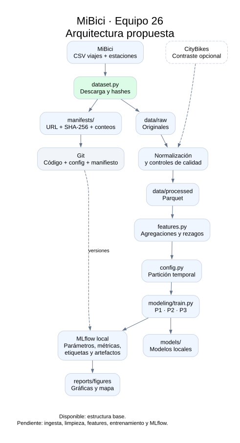
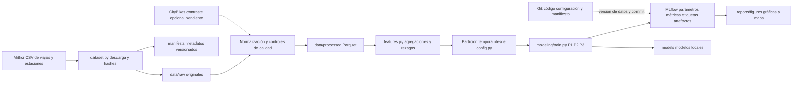

# Arquitectura propuesta de MiBici

En esta revisión solo está disponible la estructura base del repositorio.
La ingesta, normalización, features, modelos, visualizaciones y registro de
experimentos son componentes propuestos; el diagrama no acredita que ya se
ejecutaron.

## Componentes y decisiones

| Componente | Herramienta y motivo |
| --- | --- |
| Organización | CCDS separa datos, exploración, código y resultados; evita mezclar notebooks con lógica reutilizable (Wilson, 2022, cap. 6). |
| Entorno y dependencias | `requirements.txt` fija todas las versiones, incluidas las transitivas, y se instala igual con `pip` o con `uv pip`. Fijar el entorno es una de las condiciones para reproducir un resultado (Tecnológico de Monterrey, 2024). |
| Descarga | Python estándar con transferencia en bloques descarga cada CSV sin cargarlo completo en memoria; los hashes SHA-256 se guardan en un manifiesto versionado en Git (Huyen, 2022, cap. 6). |
| Limpieza y almacenamiento | pandas y PyArrow permitirán normalizar esquemas y escribir Parquet; el procesamiento debe hacerse por mes o bloques para controlar memoria. |
| Features | Funciones reutilizables en `features.py`, con rezagos calculados antes del corte de predicción. Las transformaciones aprendidas se ajustarán solo en entrenamiento, y la partición cronológica evita fuga de información del futuro (Thompson, 2023, sec. 7.4). |
| Modelos | scikit-learn para baselines y candidatos de regresión, clasificación y clustering; semilla centralizada. Cada pregunta parte de un baseline simple para que las métricas tengan contra qué compararse (Huyen, 2022, cap. 6). |
| Experimentos | MLflow Tracking con SQLite y artefactos locales; registrar fechas, versión de datos, semilla, métricas por conjunto y commit (Huyen, 2022, cap. 6; Tecnológico de Monterrey, 2024; Thompson, 2023, sec. 7.4; Wilson, 2022, cap. 6). No se propone todavía un servidor compartido. |
| Modelos registrados | Los modelos de scikit-learn se pueden guardar con el formato de modelos de MLflow; el Model Registry queda para una etapa posterior (Lauchande, 2021, cap. 5). |
| Versionado | Git conserva código, configuración y manifiestos. SHA-256 identifica archivos; los originales deben conservarse externamente para recuperar versiones antiguas (Huyen, 2022, cap. 6). |
| Figuras | Matplotlib para gráficas y ubicación de grupos por coordenadas, sin incluir datos personales. |

P1/P2 se evaluarán con entrenamiento de agosto de 2025 a julio de 2026,
validación en agosto de 2026 y prueba en septiembre de 2026. El año de
entrenamiento incluye distintas temporadas. P3 ajustará perfiles y agrupaciones con entrenamiento, seleccionará
configuraciones sin usar prueba y documentará cómo evaluar estabilidad fuera del
periodo de ajuste. Las fechas efectivas proceden de `config.py`.

CityBikes es un contraste opcional del indicador P2. Su incorporación depende de
validar cobertura, identificadores y zona horaria; no es un requisito de la
instalación inicial. Los CSV mensuales permiten evaluación retrospectiva, no
operación diaria sin una fuente de datos reciente.

## Relación con las lecturas

**Reproducibilidad.** La presentación del curso señala que un sistema de software
da los mismos resultados si no cambian el código, los datos, el modelo, el
entorno y la infraestructura, y que en ML además influyen las propiedades
estadísticas de los datos (Tecnológico de Monterrey, 2024). Por eso cada run
queda ligado a un commit de Git, a una versión de los datos y a un entorno con
dependencias fijas.

**Seguimiento y versionado de experimentos.** Huyen (2022, cap. 6) distingue el
seguimiento de experimentos, que permite comparar resultados, del versionado,
que guarda todo lo necesario para recrear un experimento. También explica que
un sistema de ML es parte código y parte datos, que los datos no se pueden
versionar línea por línea como el código y que herramientas como DVC detectan
cambios mediante checksums. El manifiesto con hashes SHA-256 aplica esa idea sin
agregar otra herramienta, y MLflow Tracking registra parámetros, métricas,
artefactos y la referencia a los datos de entrenamiento (Tecnológico de
Monterrey, 2024).

**Baselines.** Huyen (2022, cap. 6) advierte que una métrica por sí sola dice
poco si no se compara contra un baseline, como predecir al azar o con una
heurística simple. Por eso P1 usa el promedio del mismo día de la semana en las
cuatro semanas previas y P2 repite la categoría de la semana anterior antes de
probar modelos más complejos.

**Evaluación estandarizada.** Wilson (2022, cap. 6) recomienda evaluar varias
alternativas con métricas estandarizadas y funciones de evaluación reutilizables
por todo el equipo, y guardar los resultados en un servicio como MLflow en lugar
de imprimirlos, porque al terminar el run esa información se pierde. Esto
respalda las funciones comunes en el módulo `mibici` y el registro de todas las
métricas en MLflow con el conjunto en el nombre (`val_mae`, `test_mae`).

**Gestión de modelos.** Lauchande (2021, cap. 5) describe el formato de modelos
de MLflow, que separa el modelo del entorno que lo ejecuta, y el Model Registry
para manejar su ciclo de vida. En esta entrega solo se usa Tracking; el registro
de modelos queda como siguiente paso.

**Proceso de modelado y fuga de información.** Thompson (2023, sec. 7.4)
pide acordar el proceso de modelado, usar un rastreador de experimentos y un
repositorio de modelos, y documentar cada experimento como en una bitácora de
laboratorio para que los modelos se puedan reproducir y auditar. Advierte que en
series de tiempo elegir mal los conjuntos de entrenamiento y validación deja que
información del futuro se filtre al modelo; su ejemplo es un verano caluroso que
aparece en validación y en prueba. Por eso la partición es cronológica y la
prueba (septiembre de 2026) no se usa para elegir modelos. También muestra
MLflow registrando parámetros y métricas desde el código, y recomienda guardar
con cada modelo la versión del algoritmo, los hiperparámetros y el enlace a la
versión de los datos de entrenamiento, que es lo que registra cada run.

## Referencias

Huyen, C. (2022). *Designing machine learning systems: An iterative process for production-ready applications*. O’Reilly Media.

Lauchande, N. (2021). *Machine learning engineering with MLflow: Manage the end-to-end machine learning life cycle with MLflow*. Packt Publishing.

Tecnológico de Monterrey. (2024). *2.2 Tracking* [Presentación de diapositivas]. TC5044 Machine Learning Operations, Maestría en Inteligencia Artificial Aplicada.

Thompson, S. (2023). *Managing machine learning projects: From design to deployment*. Manning Publications.

Wilson, B. (2022). *Machine learning engineering in action*. Manning Publications.
