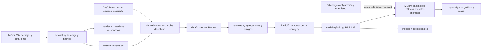

# Arquitectura propuesta de MiBici

En esta revisión solo está disponible la estructura base del repositorio.
La ingesta, normalización, features, modelos, visualizaciones y registro de
experimentos son componentes propuestos; el diagrama no acredita que ya se
ejecutaron.

## Componentes y decisiones

| Componente | Herramienta y motivo |
| --- | --- |
| Organización | CCDS separa datos, exploración, código y resultados; evita mezclar notebooks con lógica reutilizable. |
| Entorno y dependencias | `requirements.txt` fija todas las versiones, incluidas las transitivas, y se instala igual con `pip` o con `uv pip`; también lo puede usar MLflow Projects más adelante. |
| Descarga | Python estándar con transferencia en bloques descarga cada CSV sin cargarlo completo en memoria; los hashes SHA-256 se guardan en un manifiesto versionado en Git. |
| Limpieza y almacenamiento | pandas y PyArrow permitirán normalizar esquemas y escribir Parquet; el procesamiento debe hacerse por mes o bloques para controlar memoria. |
| Features | Funciones reutilizables en `features.py`, con rezagos calculados antes del corte de predicción. Las transformaciones aprendidas se ajustarán solo en entrenamiento. |
| Modelos | scikit-learn para baselines y candidatos de regresión, clasificación y clustering; semilla centralizada. |
| Experimentos | MLflow con SQLite y artefactos locales; registrar fechas, versión de datos, métricas por conjunto y commit. No se propone todavía un servidor compartido. |
| Versionado | Git conserva código, configuración y manifiestos. SHA-256 identifica archivos; los originales deben conservarse externamente para recuperar versiones antiguas. |
| Figuras | Matplotlib para gráficas y ubicación de grupos por coordenadas, sin incluir datos personales. |

P1/P2 se evaluarán con entrenamiento de agosto de 2025 a julio de 2026,
validación en agosto de 2026 y prueba en septiembre de 2026. El año de
entrenamiento incluye distintas temporadas. P3 ajustará perfiles y agrupaciones con entrenamiento, seleccionará
configuraciones sin usar prueba y documentará cómo evaluar estabilidad fuera del
periodo de ajuste. Las fechas efectivas proceden de `config.py`.

CityBikes es un contraste opcional del indicador P2. Su incorporación depende de
validar cobertura, identificadores y zona horaria; no es un requisito de la
instalación inicial. Los CSV mensuales permiten evaluación retrospectiva, no
operación diaria sin una fuente de datos reciente.

## Relación con las lecturas

El diseño propone separación de etapas y trazabilidad para facilitar la iteración
del sistema (Huyen, 2022), registro de experimentos y versionado durante el ciclo
de vida de ML (Treveil et al., 2020), y traslado de la lógica exploratoria a
módulos mantenibles (Wilson, 2022). Son justificaciones generales de diseño;
el equipo debe vincularlas con los capítulos efectivamente revisados en clase.

Huyen, C. (2022). *Designing machine learning systems: An iterative process for production-ready applications*. O’Reilly Media.

Treveil, M., Omont, N., Stenac, C., Lefevre, K., Phan, D., Zentici, J., Lavoillotte, A., Miyazaki, M., & Heidmann, L. (2020). *Introducing MLOps: How to scale machine learning in the enterprise*. O’Reilly Media.

Wilson, B. (2022). *Machine learning engineering in action*. Manning Publications.
